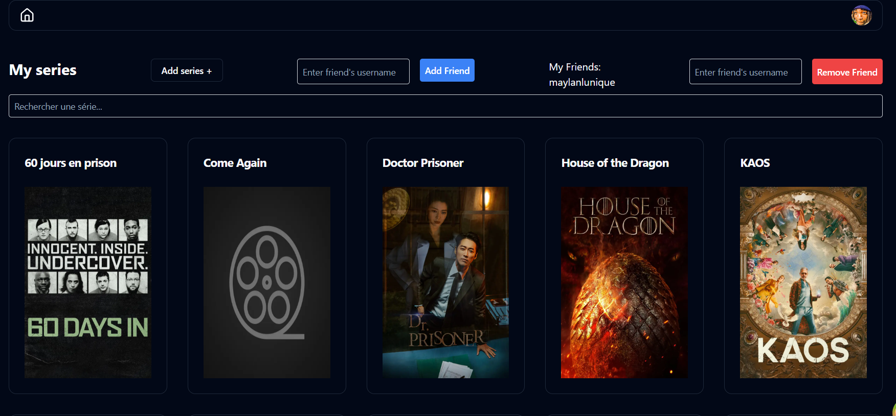

# Previously On

Track the TV shows you watch, episode by episode, on top of your [BetaSeries](https://www.betaseries.com/) account.

Live demo: https://previously-on-eight.vercel.app



## What it does

- Sign in with your BetaSeries account (OAuth) — the app stores the access token in a cookie and calls the BetaSeries API on your behalf
- See the shows in your BetaSeries library, filter them by title, and search BetaSeries to add new shows
- Open a show to browse its seasons and episodes, mark one episode or everything "up to here" as watched, unmark episodes, and archive a show
- Watch the show's trailers (YouTube embeds via `@next/third-parties`)
- Read, post, edit and delete comments on an episode
- Look up a character/actor's details
- Add and remove BetaSeries friends and see your friends list
- Dark theme by default (`next-themes`), toasts for feedback

## Stack

- Next.js 14 (App Router, server actions) + React 18 + TypeScript
- Tailwind CSS 3, shadcn/ui (Radix UI primitives), lucide-react, Headless UI
- TanStack Query 5 for client-side data fetching and mutations
- axios and a generated BetaSeries SDK (`@api/betaseries`, built with ReadMe's `api` from the OpenAPI spec in `.api/`)
- react-hook-form + zod, react-hot-toast, react-player

## Run locally

Requires Node 18+ and npm.

```bash
git clone https://github.com/lucaszebre/Previously_On.git
cd Previously_On
npm ci
cp .env.example .env.local   # then fill in the values
npm run dev                  # http://localhost:3000
```

Environment variables (see `.env.example`):

- `NEXT_PUBLIC_BETASERIES_KEY` — your BetaSeries API key (also used as the OAuth client id)
- `NEXT_PUBLIC_BETASERIES_CLIENT_SECRET` — the matching BetaSeries OAuth client secret
- `NEXT_PUBLIC_URL` — the URL this app is served from, used as the OAuth `redirect_uri`

You need a BetaSeries developer key: register an application at https://www.betaseries.com/api/ and set its callback URL to `NEXT_PUBLIC_URL`.

Other scripts: `npm run build`, `npm start`, `npm run lint`.

## Status

Built in 2024 as a two-week school project; not actively maintained.
